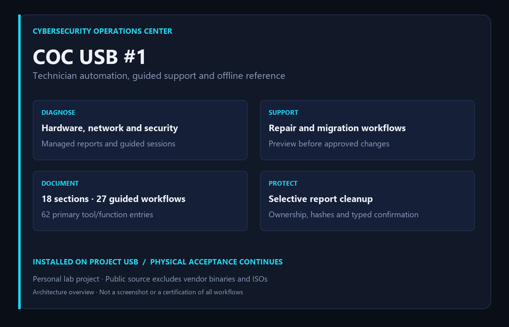
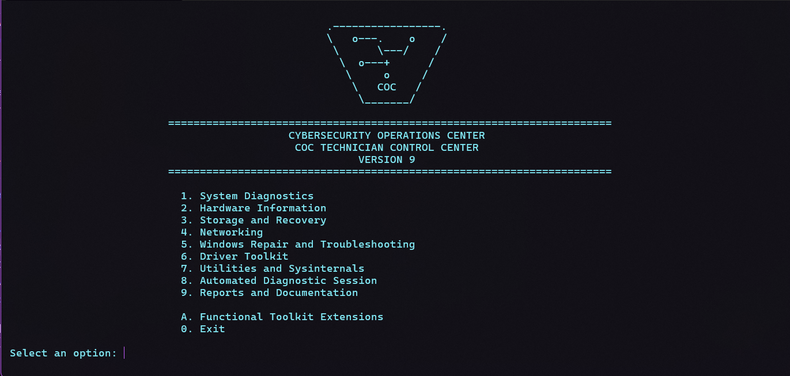
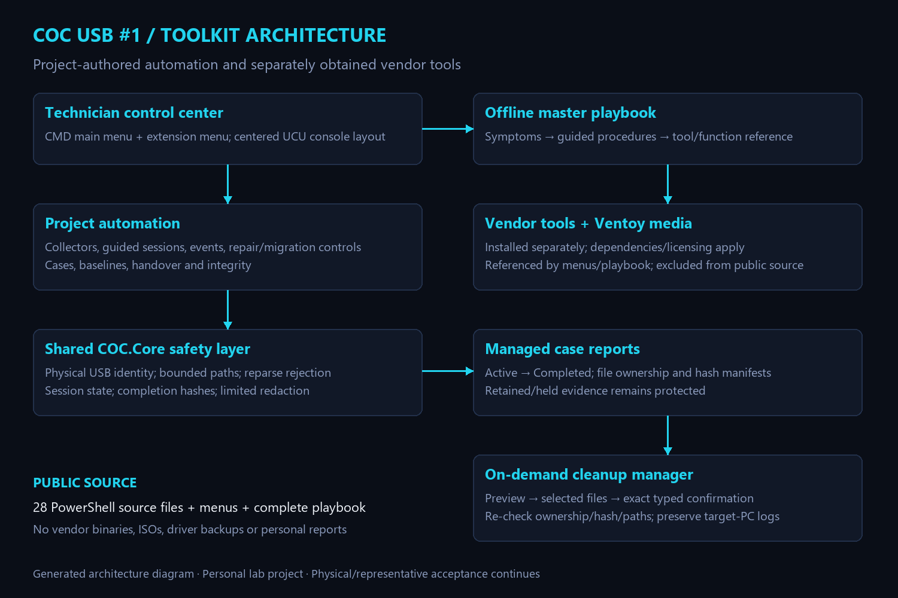

<h1 align="center">COC USB #1 — IT Technician Toolkit</h1>

<strong>Cybersecurity Operations Center</strong> Windows support automation · Offline troubleshooting · Verified rollback · UCU interface

  
  
  
  
  
  

<a href="https://scott-renny.github.io/projects/coc-usb-technician-toolkit.html"><strong>Case study</strong></a> · <a href="https://scott-renny.github.io/journal/building-a-safe-usb-technician-toolkit.html"><strong>Build journal</strong></a> · <a href="Documentation/Master-IT-Technician-Playbook.html"><strong>Offline playbook</strong></a> · <a href="docs/validation.md"><strong>Validation</strong></a>

---

A portable Windows support toolkit built for my personal Cybersecurity Operations Center. It turns an existing Ventoy USB into a guided workflow: inspect the problem, collect evidence, choose an authorized action, record the result and preserve recovery options.

The project combines **28 original PowerShell source files**, active menus, separately installed vendor tools and a **complete searchable offline playbook**. GitHub shares the engineering work without distributing a ready-made USB image.

## Installed interface

Centered title and emblem, aligned menu options and familiar CMD navigation. This is an actual screenshot from the project USB, not a generated interface mock-up.

## Capabilities at a glance

| Area | Project-authored capability | Boundary |
| --- | --- | --- |
| Diagnostics | Hardware, network, security, enterprise and event collection | Collection is not certification |
| Automation | Guided sessions, indexes, baselines, comparisons and handover | No unattended repair loop |
| Recovery | Servicing previews, account/BitLocker playbooks and file migration | Authorization and appropriate backups required |
| Cleanup | Manifest-backed selection, holds and typed confirmation | No target-PC log clearing or untracked-file deletion |
| Documentation | 18 sections, 27 workflows, 62 tool/function entries | Vendor tools obtained separately |
| Release safety | Identity/version guards, verified backups and integrity checks | Physical acceptance remains explicit |

## Our custom tools and automation

- Managed laptop, battery, driver and six network collectors; automated and guided technician sessions.
- Security/enterprise collection, filtered events and BitLocker status/protector-ID diagnostics without recording recovery passwords.
- Windows servicing with preview and explicit execution confirmation; migration with a dry run and a new destination on separate storage.
- Case indexes, configuration baselines, comparisons, handover notes, retention holds and integrity checks.
- Selective report cleanup with preview, typed confirmation and ownership/hash/path checks. Target-PC logs are not cleared.
- An offline searchable playbook: 18 sections, 27 guided workflows and 62 primary tool/function entries, with deployment and advanced diagnostic procedures.
- Shared UCU styling, an SVG shield/circuit emblem and centered main/submenu layouts.

## Status

The functional update and branding are installed on the project USB. Verification confirmed 257 functional payload files, 11 original-script backups, 552 toolkit assets before branding, and all five branding files plus four backups afterward. Disposable installer success/rollback tests and 12 console navigation paths passed. These checks establish file integrity and bounded behavior, not universal repair/boot compatibility. Physical boot, representative migration/restore and privileged enterprise acceptance remain separate work.

## Explore

- [Offline master playbook](Documentation/Master-IT-Technician-Playbook.html): clone/download and open locally; GitHub's source viewer does not execute search.
- [Our 28 PowerShell source files and launchers](docs/automation-catalogue.md)
- [Architecture](docs/architecture.md)
- [Setup and dependencies](docs/setup.md)
- [Validation and remaining acceptance](docs/validation.md)
- [Third-party licensing](THIRD_PARTY.md)

## Public source boundary

This is source/documentation, not a USB image. No ISOs, vendor executables, drivers, case output or personal reports are bundled. The core USB serial is deliberately CONFIGURE_USB_SERIAL. Independently configure and verify all identity fields before use; never weaken or skip the guard. Existing collectors assume a removable toolkit volume root. Extracting this repository onto an internal disk does not make it operational.

Menus reference tools obtained separately from official vendors. The coverage matrix describes the installed project USB, not a claim that a clone includes those assets. The device-specific integrity manifest and legacy-report ownership registry are excluded; create trusted baselines for your own assets. Unregistered legacy reports remain ineligible for cleanup.

This is a personal lab engineering project, not employment experience, a certified forensic toolkit or a production-readiness claim. Use only on authorized systems/data. No formatting, repartitioning, credential bypass or target-log clearing is part of publication.

Original project source/documentation are MIT licensed. Vendor products retain their own licenses; see THIRD_PARTY.md.

## Architecture and public evidence

The menu image above is an actual user-provided screenshot of the installed USB. The architecture and overview illustrations are generated diagrams, not screenshots.

